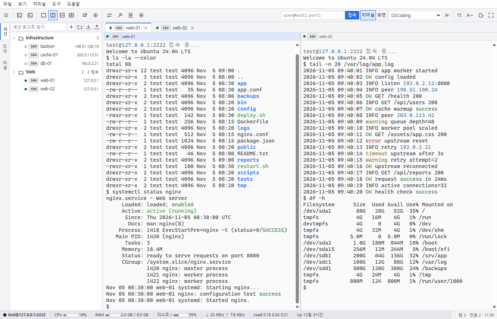
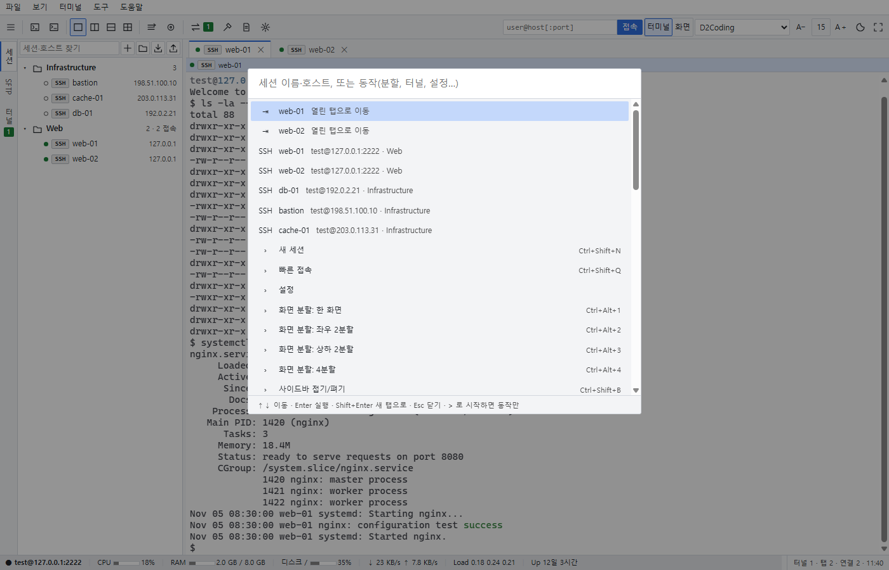
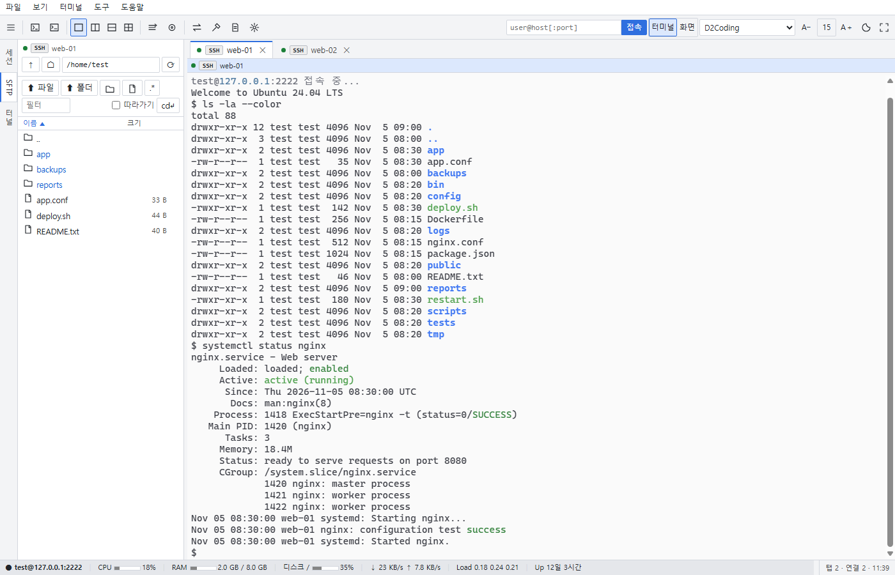
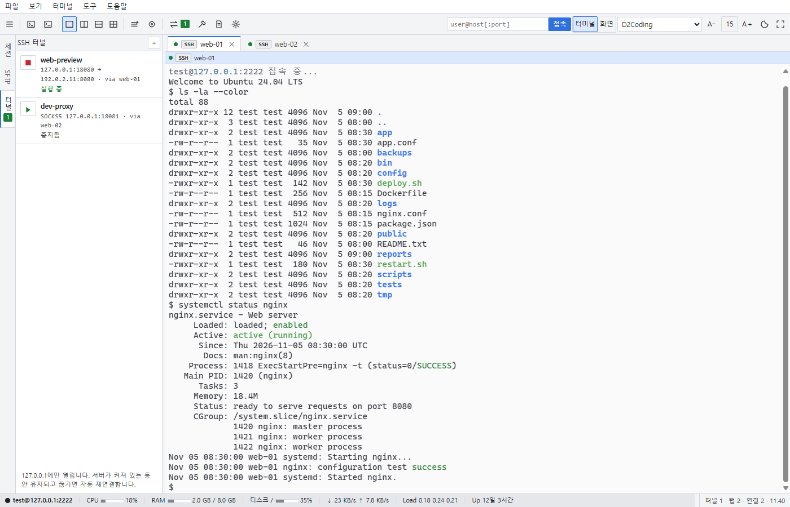
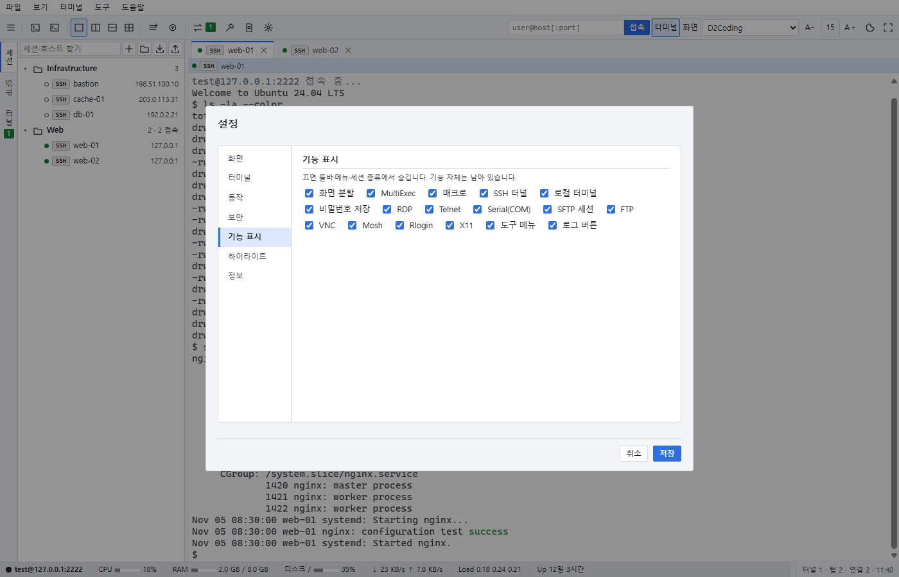

[English](README.md) | [한국어](README.ko.md)


# W.S.T — Web SSH Terminal

SSH 및 통신 기능을 브라우저로 옮긴 원격 접속 도구.




이 PC에서 실행하는 작은 Python 중계 서버가 Chrome과 원격 서버를 연결합니다.

```
Chrome(xterm.js·noVNC) ──WebSocket(127.0.0.1)── 중계 서버 ──SSH── [프록시 ─ 점프 호스트 … ──] 대상 서버
```

**요구 사항**: Windows 10/11, Google Chrome. 소스 실행 시 Python 3.14

## 주요 기능

### 세션 관리와 명령 팔레트

접속 정보를 폴더로 정리하고 검색합니다. `Ctrl+Shift+P` 또는 `F1`로 명령 팔레트를 열어 세션과 동작을 실행할 수 있습니다. SSH, SFTP 단독, RDP, Telnet, Rlogin, Serial(COM), FTP·FTPS, VNC, Mosh(WSL), 로컬 터미널을 지원합니다.



### 화면 분할과 동시 입력

한 화면, 좌우, 상하, 4분할로 터미널을 배치합니다. MultiExec로 여러 탭에 같은 입력을 보내고, 매크로를 녹화·재생하며, 터미널 출력을 검색하거나 파일로 저장할 수 있습니다.

### 파일 전송과 원격 편집

SFTP·FTP·SCP로 파일을 탐색합니다. 폴더 전송, 원격 파일 편집, 두 파일 비교를 지원하며, 두 칸 탐색기로 이 PC와 현재 서버의 파일을 함께 다룰 수 있습니다.



### SSH 터널

터널 사이드바에서 로컬 포워딩, 원격 포워딩, 동적 SOCKS5 터널을 관리합니다. 자동 시작과 재연결을 지원하며, 중계 서버가 실행 중이면 터널이 유지됩니다.



### 원격 데스크톱·모니터링·도구

Windows 원격 데스크톱 클라이언트로 RDP를 실행하고, 브라우저 안에서 VNC를 사용하며, X11 앱을 이 PC의 X 서버로 전달합니다. Linux 서버의 자원을 모니터링하고 포트 스캐너, TFTP 서버, HTTP 파일 서버, SSH 키 도구를 사용할 수 있습니다.

### 화면과 기능 설정

화면·터미널 테마, 글꼴, 단축키를 설정합니다. 쓰지 않는 메뉴와 세션 종류는 ⚙설정 → 기능 표시에서 숨길 수 있습니다.



## 시작하기

### 릴리즈 ZIP

1. [최신 릴리즈](https://github.com/rorena15/web-ssh-terminal/releases/latest)에서 ZIP을 받습니다.
2. 압축을 풀고 `W.S.T.exe`와 `_internal` 폴더를 함께 둡니다.
3. `W.S.T.exe`를 더블클릭합니다.

콘솔 창 없이 Chrome 앱 창으로 `http://127.0.0.1:8022/`가 열립니다. 인증서 설치는 필요 없습니다.

v1.0.x를 쓰던 PC에서 처음 실행하면 이전 버전이 설치한 로컬 인증서(CA)를 제거할지 묻습니다. **예**를 권장합니다. 나중에 지우려면 `W.S.T.exe --remove-legacy-ca`(소스 실행은 `python server.py --remove-legacy-ca`)를 실행합니다. 주소가 바뀌어 브라우저에만 저장되던 화면 설정(테마·글꼴·배치 등)은 한 번 초기화됩니다. 세션·설정·비밀번호 저장소는 그대로입니다.

종료하려면 ⚙설정 → 동작 → 서버 종료를 선택합니다. 앱 창을 모두 닫으면 1분 뒤 서버가 자동 종료되지만, SSH 터널이 실행 중이면 계속 유지됩니다.

이미 실행 중일 때 다시 실행하면 서버를 추가로 띄우지 않고 창만 엽니다. 오류는 메시지 창에 표시되며, 자세한 기록은 `data/server.log`에 남습니다.

### 소스 실행

필요 패키지는 `paramiko`, `websockets`, `cryptography`, `pywinpty`입니다.

```powershell
python -m pip install paramiko "websockets>=17.4" cryptography pywinpty
pythonw server.py --open --auto-exit
```

위 실행 명령은 exe를 인수 없이 실행할 때와 같은 옵션을 사용합니다.

콘솔 로그가 필요하면 `실행(콘솔).bat`을 실행합니다. 이 소스 실행 파일은 필요한 패키지가 없으면 설치합니다. `실행.vbs`도 소스 실행용으로 제공됩니다.

W.S.T는 이 PC에서만 열립니다. 다른 PC에서 접속하는 원격 모드(`--host 0.0.0.0`)는 v1.1에서 제거했습니다.

## 보안 요약

보안 모델, 알려진 문제, 취약점 제보 방법은 [SECURITY.md](SECURITY.md)에 있습니다.

- 루프백 주소(`127.0.0.1`, `::1`)에만 열리며 실행마다 만드는 접속 토큰이 있어야 합니다. 요청의 Host 헤더가 `127.0.0.1`·`localhost`·`[::1]`과 실제 포트가 아니면 거부합니다(DNS 리바인딩 방어).
- 통신은 이 PC 안(루프백)에서만 오가므로 TLS와 로컬 CA를 쓰지 않습니다. Chrome은 `http://127.0.0.1`을 안전한 출처로 취급합니다.
- WebSocket Origin 검사로 교차 사이트 WebSocket 하이재킹을 차단합니다. SSH 호스트 키는 TOFU 방식으로 확인하며, 변경된 키는 명시적으로 교체하기 전까지 접속을 거부합니다.
- 선택 사항인 비밀번호 저장소는 Windows DPAPI를 사용합니다. 마스터 비밀번호를 설정하면 scrypt와 AES-GCM 보호를 추가합니다.
- 로컬 터널은 루프백 주소에만 열립니다. 역방향 터널의 원격 바인딩 기본값은 `127.0.0.1`입니다.
- X11 포워딩은 대체 쿠키를 검사한 뒤 이 PC X 서버의 실제 쿠키로 연결합니다.

<details>
<summary>자세한 보안 동작</summary>

TFTP·HTTP 파일 서버는 기본으로 `127.0.0.1`에 열리고, 다른 주소를 고르면 같은 네트워크에 인증 없이 열린다는 확인을 거칩니다. SFTP 끌어 내려받기 주소는 한 번만 쓸 수 있습니다.

비밀번호와 키 암호는 선택 사항인 DPAPI 저장소를 통해서만 디스크에 저장합니다. 실행 중인 터널은 재연결을 위해 자격 정보를 서버 메모리에 보관합니다.

로컬 터널은 루프백 주소를 사용합니다. 기본값은 `127.0.0.1`이며, 게이트웨이 RDP는 세션별 `127.77.x.y`를 사용합니다. 역방향 포워딩의 원격 바인딩 기본값도 `127.0.0.1`입니다.

X11 포워딩에서는 원격 앱에 대체 쿠키를 전달합니다. 올바른 쿠키를 보냈을 때만 `data/x11/xauth`에 있는 이 PC X 서버의 실제 쿠키로 바꿔 연결합니다. 자동 실행하는 VcXsrv는 `-ac` 없이 `-auth`를 사용합니다.

</details>

## 빌드

앱을 종료한 뒤 별도 가상환경에서 빌드합니다. PyInstaller 6.22 이상이 필요합니다(이전 버전은 최근 Python 3.14에 들어 있는 Tcl/Tk 9를 묶지 못합니다).

```powershell
python -m venv build/.venv
build/.venv/Scripts/python -m pip install paramiko "websockets>=17.4" cryptography pywinpty "pyinstaller>=6.22"
build/.venv/Scripts/python build/build_exe.py
```

프로젝트 폴더의 `W.S.T.exe`와 `_internal/`이 교체됩니다. 빌드할 때마다 `build/version_info.txt` 파일 버전의 넷째 자리가 1씩 증가하며, 도움말 → 버전 정보에 `build(N)`으로 표시됩니다.

Python 코드를 변경하면 exe를 다시 빌드해야 합니다. `static/` 변경은 창에서 `F5`로 새로고침해 반영할 수 있습니다.

아이콘은 `build/webssh.ico`, `static/favicon.ico`에 있으며 `build/make_icon.py`로 생성합니다. 소스 실행은 `build/version_info.txt`에서 버전을 읽고, exe 빌드는 같은 파일을 `_internal/version_info.txt`로 포함합니다.

## 라이선스

GPL-3.0-or-later.

© 2026 rorena15.

이 저장소는 공개를 위해 기록을 정리한 버전입니다. 2026년 10월부터의 개발 과정과 리뷰 기록은 별도 저장소에 보관하고 있습니다.

오픈소스 고지와 사용한 라이브러리의 라이선스 전문은 앱의 도움말 → 버전 정보 → 라이선스에서 확인할 수 있습니다. 원문은 `static/licenses/`에 있습니다.

## 참고 자료

<details>
<summary>자세한 기능 목록</summary>

### 세션

- 종류: SSH, SFTP 단독, RDP, Telnet, Rlogin, Serial(COM), FTP·FTPS, VNC, Mosh(WSL), 로컬 터미널.
- 세션 폴더 트리: 하위 폴더, 끌어다 놓아 이동, 검색, 더블클릭 접속, 우클릭으로 편집·복제·삭제·바탕화면 바로가기. 폴더 모두 열기와 색 라벨 지원.
- 명령 팔레트(`Ctrl+Shift+P` / `F1`): 세션과 동작을 이름으로 검색해 실행.
- `.ini` / `.mxtsessions` 파일에서 SSH·RDP 세션과 폴더 구조 가져오기. 비밀번호는 가져오지 않음. 세션 내보내기와 공유 세션 파일 지원. 공유 경로는 설정에서 지정.
- 저장된 SSH 세션을 사용하는 여러 단계의 점프 호스트 사슬, SOCKS5·HTTP CONNECT 프록시, 압축, 유휴 방지, SSH 에이전트(Pageant / Windows OpenSSH).
- 개인키: OpenSSH, PEM, PuTTY `.ppk`. `.ppk`는 v2/v3 무암호와 v2 암호 형식 지원. 키 암호가 틀리면 다시 입력 요청.
- 선택 사항인 비밀번호 저장소: 접속 창의 이 PC에 저장을 선택하면 `data/vault.bin`을 Windows DPAPI로 암호화. 같은 PC의 같은 Windows 계정에서만 복호화. 마스터 비밀번호를 설정하면 scrypt와 AES-GCM으로 추가 보호. 저장하지 않으면 창을 닫을 때까지만 메모리에 기억.
- 자동 재접속: 연결이 끊기면 3·5·10·20·30초 간격으로 재시도. 직접 `exit`한 경우에는 재접속하지 않음. 끊긴 탭에서 `R`은 재접속, `Enter`는 탭 닫기.
- 로그인 후 명령과 매크로.
- 세션 로그: 타임스탬프 선택, 색상코드 제거, `logs/<세션>/<날짜_시각>_<host>.log`에 기록.
- 세션별 터미널 글꼴·스크롤백·UTF-8/EUC-KR 인코딩.
- 호스트 키 TOFU 기록은 `data/known_hosts`에 저장. 키가 바뀌면 경고하며, 서버 교체가 확실할 때만 새 키로 교체를 선택.

### 터미널

- 한 화면, 좌우, 상하, 4분할(`Ctrl+Alt+1`~`4`).
- 탭 이름 바꾸기, 순서 끌기, 활동 표시, 새 창으로 분리(`Ctrl+Shift+D`).
- MultiExec(`Ctrl+Shift+M`)로 여러 탭에 같은 입력. 매크로 녹화·재생.
- 터미널에서 찾기(`Ctrl+Shift+F`), 출력 저장(`Ctrl+Shift+S`).
- 붙여넣기 미리보기와 `rm -rf` 등 위험 명령 경고.
- 키워드 하이라이트: `error`·`fail`·`denied`는 빨강, `warning`·`timeout`은 노랑, `ok`·`success`는 초록, IP는 파랑. 정규식과 색 편집 가능. 화면에만 적용하며 로그·복사는 원본 유지.
- 설정에서 켜는 팝업 터미널: 어디서든 `Ctrl+Alt+M`으로 창 띄우기·숨기기.
- 화면 잠금(`Ctrl+Alt+L`), 전체화면(`F11`).
- 드래그로 복사, 우클릭으로 붙여넣기. `Ctrl+Shift+C`·`Ctrl+Shift+V`도 지원.

### 파일

SFTP·FTP·SCP 사이드바는 SSH 접속 시 자동으로 열립니다.

- 터미널 폴더 따라가기: Linux에서 터미널의 `cd`에 맞춰 SFTP 폴더 이동. `cd↵` 버튼은 반대 방향으로 터미널 폴더 이동.
- 원격 파일 바로 편집, `Ctrl+S` 저장. 서버에서 변경된 파일을 덮어쓰기 전에 경고하며 EUC-KR 인코딩과 CRLF 줄바꿈 유지.
- diff로 두 파일 비교.
- 폴더 통째로 업로드·다운로드, 끌어다 놓기 지원.
- 권한·소유자 변경, 정렬, 숨김 파일 표시, 검색, 여러 개 선택, `Del` 삭제, `F2` 이름 변경.
- 이 PC 파일 탭과 이 PC ↔ 현재 서버의 두 칸 탐색기.
- SFTP가 막힌 서버용 SCP 모드.
- SFTP와 셸 명령 대체가 모두 안 되는 장비에서는 SFTP 탭에 원인·원문 오류·다시 시도 화면 표시.

### 원격 데스크톱·GUI

- RDP 세션을 더블클릭하면 Windows 원격 데스크톱(`mstsc`) 실행. 저장된 RDP 비밀번호는 Windows 자격 증명으로 전달.
- SSH 게이트웨이 경유 시 세션마다 다른 루프백 주소(`127.77.x.y`)로 터널을 열어 중계. 여러 서버를 동시에 열어도 자격 증명을 분리하며, RDP 창을 닫으면 터널과 자격 증명 자동 정리.
- VNC는 브라우저 안에서 실행. SSH 게이트웨이 경유, `Ctrl+Alt+Del`과 클립보드 보내기 지원.
- X11 포워딩으로 원격 GUI 앱을 이 PC의 X 서버(VcXsrv·X410·Xming)에 표시. VcXsrv가 설치되어 있으면 자동 실행.

### 터널·모니터링·도구

- 터널 사이드바에서 로컬 포워딩, 원격·역방향 포워딩, 동적 SOCKS5 관리.
- 터널 시작·중지, 앱 시작 때 자동 시작, 연결이 끊기면 5초마다 재연결.
- Chrome 창을 닫아도 서버가 실행 중이면 터널 유지.
- 원격 모니터링 바: 현재 탭의 Linux 서버 CPU·메모리·디스크·네트워크·Load·가동 시간을 3초마다 갱신. 클릭하면 상위 프로세스·전체 디스크·열린 포트 표시.
- 툴바의 도구: 포트 스캐너, 이 PC의 열린 포트, TFTP 서버, HTTP 파일 서버, SSH 키 생성과 서버 공개키 등록.
- 로컬 터미널(`Ctrl+Alt+T`): PowerShell, cmd, WSL.

### 화면·설정

- 화면 테마와 터미널 색을 따로 설정하며 바로 미리보기. 화면은 라이트·다크·Windows 따라가기 지원.
- 툴바의 `[터미널|화면]`에서 대상을 고른 뒤 글꼴 선택 또는 `A−`·`A＋` 사용. 크기 숫자를 누르면 기본값으로 복원.
- 터미널 글자 크기는 9~32, 화면 글자 크기는 11~18px. 화면 설정은 메뉴·트리·탭·대화상자에 적용. 두 크기는 따로 저장하며 `Ctrl`+휠은 터미널 글자 크기 조절.
- 설정 창의 세로 탭: 화면, 터미널, 동작, 보안, 기능 표시, 하이라이트, 정보.
- 서버 종료는 동작 탭에 위치.
- 도움말에서 단축키 안내와 버전 정보 확인. 버전 정보에는 버전·`build(N)`·실행 환경과 라이선스 창 진입 제공.
- 기능 표시에서 쓰지 않는 메뉴·세션 종류 숨기기. 단축키 설정 지원.
- 로그 폴더·RDP·X 서버 등 외부 창은 `wst/foreground.py`를 통해 맨 앞으로 표시.

### 화면 구성과 상태 표시

- 왼쪽 세로 탭인 세션·SFTP·터널은 하나만 활성화. 활성 탭을 다시 누르면 사이드바 접기.
- 접속하면 SFTP 탭으로 이동. 세션이 끝나 보여 줄 SFTP가 없으면 세션 탭으로 복귀.
- 트리·탭·칸 머리줄은 `[상태 점] [프로토콜] 이름 [운영]` 순서. 빈 원은 열린 탭이 없다는 뜻이며, 빨간 `운영`은 빨강 색 라벨 세션 표시.
- 입력을 받는 칸은 파란 머리줄로 표시. MultiExec 대상 칸에는 `동시입력` 표시.
- 상태 바 막대는 70% 이상 주황, 90% 이상 빨강.

</details>

<details>
<summary>단축키 기본값</summary>

| 동작 | 키 |
|---|---|
| 명령 팔레트 | Ctrl+Shift+P / F1 |
| 새 세션 / 빠른 접속 | Ctrl+Alt+N (Ctrl+Shift+N) / Ctrl+Shift+Q |
| 탭 닫기 / 이동 / 복제 | Ctrl+Alt+W / Ctrl+Tab, Ctrl+Alt+←→ / Ctrl+Shift+U |
| 화면 분할 | Ctrl+Alt+1~4 |
| SFTP ↔ 세션 사이드바 / 사이드바 접기 | Ctrl+Alt+F / Ctrl+Shift+B |
| 찾기 / 출력 저장 | Ctrl+Shift+F / Ctrl+Shift+S |
| MultiExec / 탭 분리 | Ctrl+Shift+M / Ctrl+Shift+D |
| 로컬 터미널 / 화면 잠금 / 팝업 터미널 | Ctrl+Alt+T / Ctrl+Alt+L / Ctrl+Alt+M |
| 끊긴 탭: 재접속 / 탭 닫기 | R / Enter |
| 전체화면: Ctrl+W 등도 터미널로 전달 | F11 또는 전체화면 버튼 |

</details>

<details>
<summary>실행과 Windows 연동 상세</summary>

- 작업표시줄 고정: 앱 창이 열린 뒤 작업표시줄 아이콘 우클릭 → 고정. Chrome과 따로 묶이며, `wst/taskbar.py`가 Chrome 앱 창에 AppUserModelID를 지정.
- 작업표시줄 ID는 `rorena15.WST`.
- 시작프로그램은 레지스트리 `HKCU\...\Run`의 `WebSSHTerminal`로 등록. 작업 관리자 → 시작 앱에서 해제. exe 폴더를 옮기면 다시 등록.
- 저장된 세션에 바로 접속:

  ```powershell
  W.S.T.exe --session "<세션 이름>"
  ```

  또는 세션 우클릭 → 바탕화면 바로가기.
- `실행(콘솔).bat`은 콘솔 로그를 보여 주는 소스 실행용이며, `실행.vbs`도 소스 실행용.

</details>

<details>
<summary>파일 구조</summary>

| 경로 | 역할 |
|---|---|
| `server.py` | HTTPS·WebSocket 라우팅, 실행 옵션 |
| `wst/term.py` | SSH 터미널 중계, 세션 로그, 모니터링, 터미널 폴더 추적 |
| `wst/rawterm.py` | Telnet·Rlogin·Serial(COM) |
| `wst/sftp.py`, `wst/fsadapt.py`, `wst/ftpconn.py` | SFTP / 이 PC·SCP / FTP·FTPS를 같은 인터페이스로 제공하는 파일 탐색기 |
| `wst/sshconn.py`, `wst/ppk.py` | SSH 접속·점프·프록시·호스트 키·개인키, `.ppk` 변환 |
| `wst/tunnels.py` | 로컬·원격 포워딩·SOCKS5, 자동 재연결 |
| `wst/vault.py` | DPAPI 비밀번호 저장소, 마스터 비밀번호, RDP 자격 증명 등록 |
| `wst/vncproxy.py`, `wst/x11.py` | VNC 중계, X11 포워딩 |
| `wst/tools.py` | 포트 스캐너·TFTP·HTTP 서버·키 생성 |
| `wst/localterm.py` | ConPTY 로컬 터미널 |
| `wst/api.py` | 세션 트리·설정 저장, 터널 제어, RDP 실행, 버전 정보 |
| `wst/hotkey.py`, `wst/taskbar.py`, `wst/foreground.py` | 팝업 터미널 전역 단축키, 작업표시줄 아이콘, 외부 창을 맨 앞으로 표시 |
| `wst/tls.py`, `wst/common.py` | 이전 버전 로컬 CA 정리, 공통 설정 |
| `static/` | 화면 JavaScript: `core`·`app`·`tree`·`sftp`·`tunnels`·`vnc`·`multiexec`·`palette`·`tools`·`diff`·`highlight`·`themes`·`termx`·`about`. `licenses/`에는 오픈소스 라이선스 |
| `data/` | 세션·폴더·터널용 `sessions.json`, `settings.json`, `known_hosts`, `vault.bin`, `rdp/`, `x11/`. 백업은 이 폴더만 |
| `logs/` | 세션 로그. 설정에서 위치 변경 가능 |
| `dev/` | 시험용 가짜 SSH·Telnet·FTP·VNC 서버와 Chrome CDP 시험. `dev/README.md` 참고 |
| `docs/` | 진행표 `ROADMAP.md`, 기능 격차표 `GAP.md`, 보안 진단 보고서 `SECURITY_*.md`, README 이미지 `images/` |
| `build/build_exe.py`, `build/version_info.txt`, `build/make_icon.py`, `build/webssh.ico`, `build/apply.ps1` | exe 빌드, 빌드 번호 자동 증가, exe 버전 정보 |

</details>
