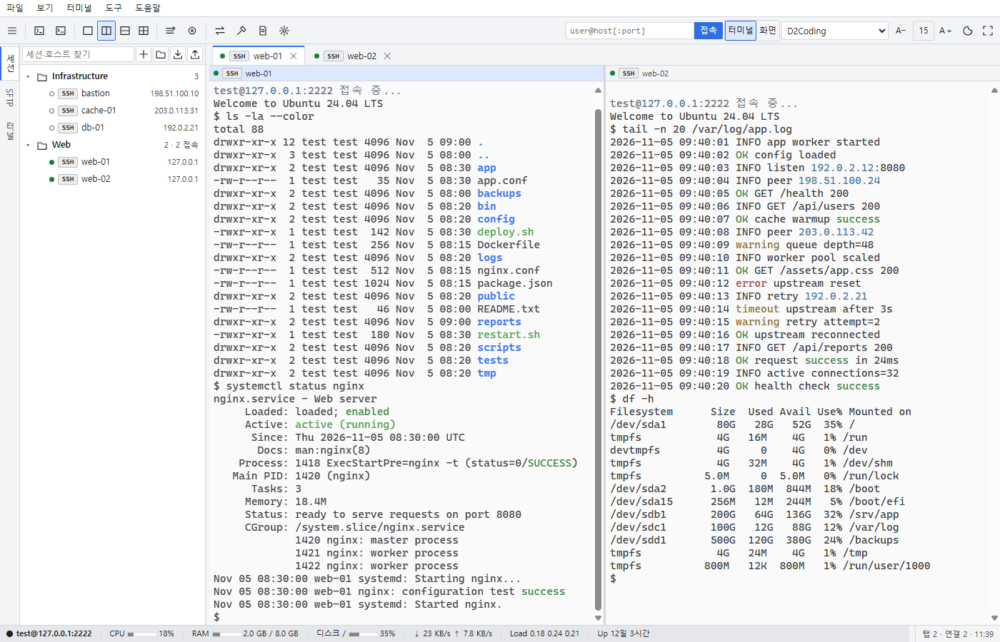
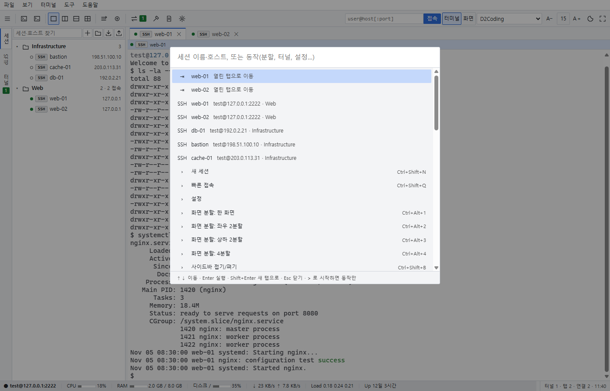
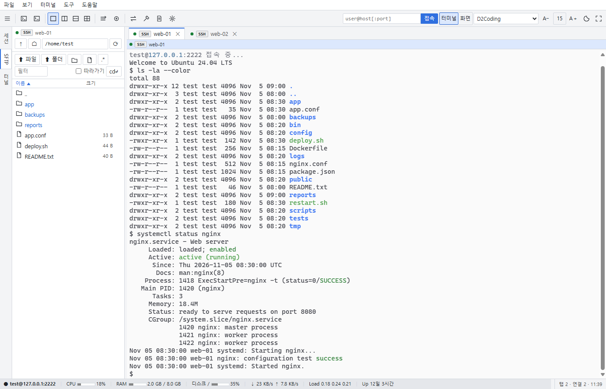
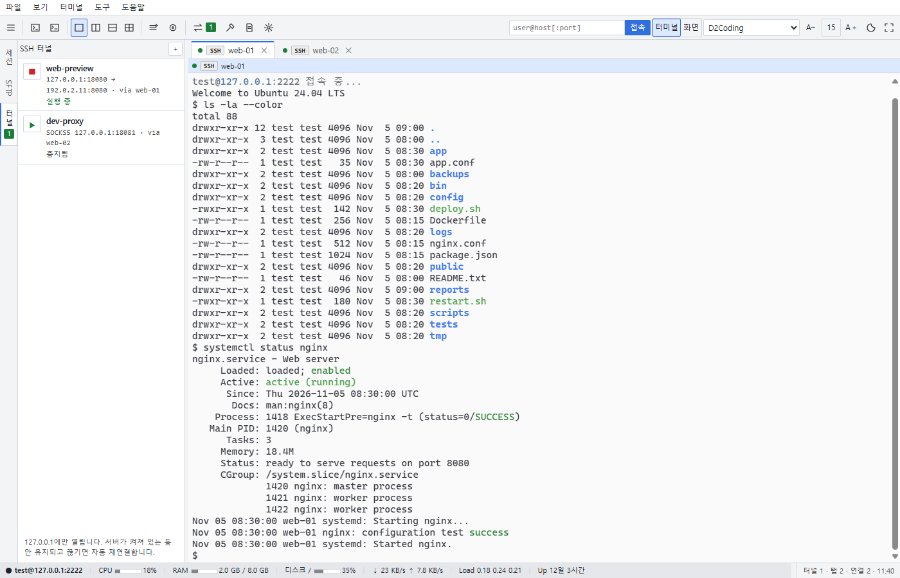
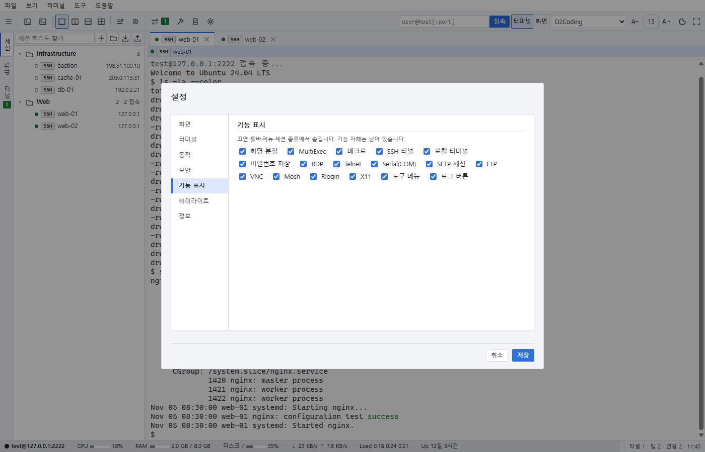

[English](README.md) | [한국어](README.ko.md)


# W.S.T — Web SSH Terminal

A remote access tool that brings SSH and communication features to the browser.




A small Python relay server running on this PC connects Chrome to remote servers.

```
Chrome (xterm.js, noVNC) ──WSS── relay server ──SSH── [proxy ─ jump hosts … ──] target server
```

**Requirements**: Windows 10/11, Google Chrome. Python 3.14 to run from source. The UI is currently Korean only.

## Main features

### Sessions and command palette

Organize connections in folders, search sessions, and open sessions or actions from the command palette with `Ctrl+Shift+P` or `F1`. Session types include SSH, standalone SFTP, RDP, Telnet, Rlogin, Serial(COM), FTP/FTPS, VNC, Mosh(WSL), and local terminals.



### Split terminals and shared input

Use a single pane, side-by-side panes, stacked panes, or four panes. Send the same input to multiple tabs with MultiExec, record and replay macros, search terminal output, and save output to a file.

### File transfer and remote editing

Browse files through SFTP, FTP, or SCP. Transfer folders, edit remote files, compare two files, and work with local and remote files in a two-pane explorer.



### SSH tunnels

Manage local forwarding, remote forwarding, and dynamic SOCKS5 tunnels from the Tunnels (터널) sidebar. Tunnels support automatic startup and reconnection, and remain active while the relay server is running.



### Remote desktops, monitoring, and tools

Launch RDP connections through the Windows remote desktop client, use VNC in the browser, and forward X11 applications to a local X server. Monitor Linux server resources and use the port scanner, TFTP server, HTTP file server, and SSH key tools.

### Display and feature settings

Configure interface and terminal themes, fonts, and shortcuts. Hide unused menus and session types under Settings (⚙설정) → Feature visibility (기능 표시).



## Getting started

### Release ZIP

1. Download the release ZIP from the [latest release](https://github.com/rorena15/web-ssh-terminal/releases/latest).
2. Extract it and keep `W.S.T.exe` beside its `_internal` folder.
3. Double-click `W.S.T.exe`.

The app opens `https://127.0.0.1:8022/` in a Chrome app window without a console window.

On the first launch, Windows displays a certificate installation prompt. Choose Yes (예) to install a local CA used only on this PC. Chrome will not show certificate warnings afterwards.

To stop the server, open Settings (⚙설정) → Behavior (동작) → Shut down server (서버 종료). Closing all app windows also stops the server after one minute, unless an SSH tunnel is running.

If W.S.T is already running, launching it again opens another window without starting another server. Errors appear in a message window; detailed logs are written to `data/server.log`.

### Run from source

Required packages: `paramiko`, `websockets`, `cryptography`, and `pywinpty`.

```powershell
python -m pip install paramiko "websockets>=17.4" cryptography pywinpty
pythonw server.py --open --trust --auto-exit
```

The launch command uses the same options as running the executable without arguments.

For console logs, run `실행(콘솔).bat`. This source launcher installs the required packages if they are missing. `실행.vbs` is also provided for launching from source.

To accept connections from other PCs:

```powershell
python server.py --host 0.0.0.0
```

Remote mode requires a token and disables features that control the host PC. See the security notes below.

## Security

- The default bind address is `127.0.0.1`. Remote mode requires a token and restricts access to host-PC features.
- HTTPS uses a local CA with Name Constraints for localhost and private IP addresses.
- WebSocket Origin checks protect against cross-site WebSocket hijacking. SSH host keys use trust on first use (TOFU); a changed key is rejected until explicitly replaced.
- Optional password storage uses Windows DPAPI. A master password adds a scrypt and AES-GCM layer.
- Local tunnels listen only on loopback addresses. Reverse tunnels default to a remote bind address of `127.0.0.1`.
- X11 forwarding checks a substitute cookie before connecting with the local X server's real cookie.

<details>
<summary>Detailed security behavior</summary>

Remote mode (`--host 0.0.0.0`) disables local terminals, RDP launching, file selection dialogs, host-PC private key files, SSH agents, reverse tunnels, X11, Serial, and host-PC path settings for logs and shared sessions. It also blocks direct VNC, Telnet, and proxy connections to services on the host PC's `127.0.0.1`.

Passwords and key passphrases are written to disk only through the optional DPAPI vault. Running tunnels retain credentials in server memory for reconnection.

Local tunnels use loopback addresses: normally `127.0.0.1`, or a session-specific `127.77.x.y` address for gateway RDP. The default remote bind address for reverse forwarding is also `127.0.0.1`.

For X11 forwarding, the remote application receives a substitute cookie. Only a matching cookie is replaced with the local X server's real cookie from `data/x11/xauth`. The automatically launched VcXsrv uses `-auth` without `-ac`.

</details>

## Build

Close the app, then build in a separate virtual environment. PyInstaller 6.22 or later is required (older versions cannot bundle the Tcl/Tk 9 shipped with recent Python 3.14 releases).

```powershell
python -m venv build/.venv
build/.venv/Scripts/python -m pip install paramiko "websockets>=17.4" cryptography pywinpty "pyinstaller>=6.22"
build/.venv/Scripts/python build/build_exe.py
```

The build replaces `W.S.T.exe` and `_internal/` in the project folder. Each build increments the fourth component of the file version in `build/version_info.txt`. The build number appears as `build(N)` under Help (도움말) → Version information (버전 정보).

Python changes require rebuilding the executable. Changes under `static/` can be reloaded with `F5`.

Icons are stored in `build/webssh.ico` and `static/favicon.ico`, and generated by `build/make_icon.py`. Source runs read version information from `build/version_info.txt`; executable builds include it as `_internal/version_info.txt`.

## License

GPL-3.0-or-later.

© 2026 rorena15.

Open-source notices and full dependency license texts are available in the app under Help (도움말) → Version information (버전 정보) → Licenses (라이선스). The texts are stored in `static/licenses/`.

## Reference

<details>
<summary>Detailed feature list</summary>

### Sessions

- Session types: SSH, standalone SFTP, RDP, Telnet, Rlogin, Serial(COM), FTP/FTPS, VNC, Mosh(WSL), and local terminals.
- Folder tree with nested folders, drag-and-drop movement, search, double-click connections, and context-menu actions for editing, duplication, deletion, and desktop shortcuts. Open all sessions in a folder and assign color labels.
- Command palette (`Ctrl+Shift+P` / `F1`) for finding and running sessions and actions by name.
- Import `.ini` and `.mxtsessions` files with SSH/RDP sessions and folder structure. Passwords are not imported. Session export and shared session files are also supported; configure the shared path in Settings (⚙설정).
- Multi-stage jump-host chains using saved SSH sessions, SOCKS5 and HTTP CONNECT proxies, compression, keepalive, and SSH agents (Pageant / Windows OpenSSH).
- OpenSSH, PEM, and PuTTY `.ppk` private keys: unencrypted v2/v3 and encrypted v2 `.ppk` files. Incorrect key passphrases trigger another prompt.
- Optional password vault: select Save on this PC (이 PC에 저장) in the connection dialog. `data/vault.bin` is encrypted with Windows DPAPI and can be decrypted only by the same Windows account on the same PC. A master password adds scrypt and AES-GCM protection. Without saving, credentials are remembered in memory until the window closes.
- Automatic reconnection after disconnection, with retry intervals of 3, 5, 10, 20, and 30 seconds. An explicit `exit` does not trigger reconnection. In a disconnected tab, press `R` to reconnect or `Enter` to close it.
- Post-login commands and macros.
- Session logs with optional timestamps and color codes removed: `logs/<session>/<date_time>_<host>.log`.
- Per-session terminal fonts, scrollback, and UTF-8/EUC-KR encoding.
- TOFU host-key records in `data/known_hosts`. Replace a changed key using Replace with new key (새 키로 교체) only after confirming that the server was replaced.

### Terminal

- Single-pane, side-by-side, stacked, and four-pane layouts (`Ctrl+Alt+1`–`4`).
- Rename and reorder tabs, view activity indicators, and detach a tab into a new window (`Ctrl+Shift+D`).
- MultiExec (`Ctrl+Shift+M`) sends the same input to multiple tabs. Macros support recording and playback.
- Search terminal output (`Ctrl+Shift+F`) and save output (`Ctrl+Shift+S`).
- Paste preview and warnings for dangerous commands such as `rm -rf`.
- Keyword highlighting: `error`, `fail`, and `denied` in red; `warning` and `timeout` in yellow; `ok` and `success` in green; IP addresses in blue. Edit regular expressions and colors. Highlighting affects the display only; logs and copied text retain the original content.
- Optional global popup terminal: show or hide the window with `Ctrl+Alt+M` after enabling it in Settings (⚙설정).
- Screen lock (`Ctrl+Alt+L`) and fullscreen (`F11`).
- Drag to copy and right-click to paste; `Ctrl+Shift+C` and `Ctrl+Shift+V` are also available.

### Files

The SFTP/FTP/SCP sidebar opens automatically when an SSH connection is established.

- Follow the terminal directory on Linux: terminal `cd` changes the SFTP directory. The `cd↵` control changes the terminal directory in the other direction.
- Edit remote files and save with `Ctrl+S`. Warn before overwriting a file changed on the server, and preserve EUC-KR encoding and CRLF line endings.
- Compare two files with diff.
- Upload and download entire folders, including drag-and-drop transfers.
- Change permissions and ownership; sort, show hidden files, search, select multiple items, delete with `Del`, and rename with `F2`.
- Local file tab and a two-pane explorer for the host PC and current server.
- SCP mode for servers where SFTP is unavailable.
- If neither SFTP nor shell-command fallback works, the SFTP tab displays the cause, the original error, and a retry screen.

### Remote desktops and GUI

- RDP sessions launch the Windows remote desktop client (`mstsc`) on double-click. Saved RDP passwords are passed through Windows credentials.
- Route through SSH gateway (SSH 게이트웨이 경유) creates a tunnel on a distinct loopback address (`127.77.x.y`) for each session, keeping credentials separate when multiple servers are open. Closing the RDP window cleans up the tunnel and credentials.
- VNC runs inside the browser, supports an SSH gateway, and can send `Ctrl+Alt+Del` and clipboard contents.
- X11 forwarding displays remote GUI applications through an X server on this PC (VcXsrv, X410, Xming). VcXsrv is launched automatically if installed.

### Tunnels, monitoring, and tools

- The Tunnels (터널) sidebar manages local forwarding, remote/reverse forwarding, and dynamic SOCKS5 tunnels.
- Start and stop tunnels, enable automatic startup with the app, and reconnect every five seconds after disconnection.
- Tunnels keep running after the Chrome window closes, as long as the server is running.
- The remote monitoring bar shows the current tab's Linux server CPU, memory, disk, network, load, and uptime, refreshed every three seconds. Click it for top processes, all disks, and open ports.
- Tools (도구) provides a port scanner, host-PC open ports, a TFTP server, an HTTP file server, SSH key generation, and public-key installation on a server.
- Local terminals (`Ctrl+Alt+T`): PowerShell, cmd, and WSL.

### Display and settings

- Configure interface themes separately from terminal colors, with immediate preview. Interface themes include light, dark, and following Windows.
- Choose Terminal (터미널) or Interface (화면) in the toolbar, then select a font or use `A−`/`A＋`. Click the size number to restore the default.
- Terminal font sizes are 9–32; interface sizes are 11–18 px. Interface sizing covers menus, trees, tabs, and dialogs. The two sizes are saved separately. `Ctrl`+mouse wheel adjusts terminal text.
- Settings (⚙설정) has Interface (화면), Terminal (터미널), Behavior (동작), Security (보안), Feature visibility (기능 표시), Highlighting (하이라이트), and Information (정보) tabs.
- Shut down server (서버 종료) is in Behavior (동작).
- Help (도움말) includes shortcut guidance and Version information (버전 정보), showing the version, `build(N)`, and runtime environment, with access to Licenses (라이선스).
- Hide unused menus and session types through Feature visibility (기능 표시), and configure keyboard shortcuts.
- External windows such as the log folder, RDP, and X server are brought to the foreground by `wst/foreground.py`.

### Screen layout and indicators

- Only one left sidebar tab—Sessions (세션), SFTP, or Tunnels (터널)—is active at a time. Clicking the active tab collapses the sidebar.
- A connection switches to SFTP. When the session ends and there is no SFTP view to show, the sidebar returns to Sessions (세션).
- Tree entries, tabs, and pane headers use the order `[status dot] [protocol] name [운영]`. An empty circle means no open tab. A red `운영` label identifies a session with a red color label.
- The pane receiving input has a blue header. MultiExec target panes show Simultaneous input (동시입력).
- Status-bar meters turn orange at 70% and red at 90%.

</details>

<details>
<summary>Default keyboard shortcuts</summary>

| Action | Shortcut |
|---|---|
| Command palette | Ctrl+Shift+P / F1 |
| New session / Quick connect | Ctrl+Alt+N (Ctrl+Shift+N) / Ctrl+Shift+Q |
| Close tab / Switch tabs / Duplicate tab | Ctrl+Alt+W / Ctrl+Tab, Ctrl+Alt+←→ / Ctrl+Shift+U |
| Pane layout | Ctrl+Alt+1–4 |
| Switch SFTP ↔ Sessions sidebar / Collapse sidebar | Ctrl+Alt+F / Ctrl+Shift+B |
| Find / Save output | Ctrl+Shift+F / Ctrl+Shift+S |
| MultiExec / Detach tab | Ctrl+Shift+M / Ctrl+Shift+D |
| Local terminal / Screen lock / Popup terminal | Ctrl+Alt+T / Ctrl+Alt+L / Ctrl+Alt+M |
| Disconnected tab: reconnect / close | R / Enter |
| Fullscreen; keys such as Ctrl+W go to the terminal | F11 or the fullscreen button |

</details>

<details>
<summary>Launch and Windows integration details</summary>

- Pin the app using the taskbar icon's context menu after opening it. The app is grouped separately from Chrome; `wst/taskbar.py` assigns an AppUserModelID to the Chrome app window.
- Taskbar ID: `rorena15.WST`.
- Startup registration uses `WebSSHTerminal` under `HKCU\...\Run`. Disable it through Task Manager (작업 관리자) → Startup apps (시작 앱). Register again after moving the executable folder.
- Open a saved session directly:

  ```powershell
  W.S.T.exe --session "<session name>"
  ```

  Alternatively, right-click a session and choose Desktop shortcut (바탕화면 바로가기).
- `실행(콘솔).bat` runs from source with console logs; `실행.vbs` is another source launcher.

</details>

<details>
<summary>File structure</summary>

| Path | Role |
|---|---|
| `server.py` | HTTPS/WebSocket routing and launch options |
| `wst/term.py` | SSH terminal relay, session logs, monitoring, and terminal directory tracking |
| `wst/rawterm.py` | Telnet, Rlogin, and Serial(COM) |
| `wst/sftp.py`, `wst/fsadapt.py`, `wst/ftpconn.py` | Shared file explorer interface for SFTP, local files/SCP, and FTP/FTPS |
| `wst/sshconn.py`, `wst/ppk.py` | SSH connections, jump hosts, proxies, host keys, private keys, and `.ppk` conversion |
| `wst/tunnels.py` | Local/remote forwarding, SOCKS5, and automatic reconnection |
| `wst/vault.py` | DPAPI password vault, master password, and RDP credential registration |
| `wst/vncproxy.py`, `wst/x11.py` | VNC relay and X11 forwarding |
| `wst/tools.py` | Port scanner, TFTP/HTTP servers, and key generation |
| `wst/localterm.py` | Local terminal through ConPTY |
| `wst/api.py` | Session tree and settings persistence, tunnel control, RDP launching, and version information |
| `wst/hotkey.py`, `wst/taskbar.py`, `wst/foreground.py` | Global popup-terminal shortcut, taskbar icon, and foreground handling |
| `wst/tls.py`, `wst/common.py` | Certificates and shared configuration |
| `static/` | Interface modules: `core`, `app`, `tree`, `sftp`, `tunnels`, `vnc`, `multiexec`, `palette`, `tools`, `diff`, `highlight`, `themes`, `termx`, and `about` JavaScript; dependency licenses under `licenses/` |
| `data/` | `sessions.json` for sessions/folders/tunnels, `settings.json`, `known_hosts`, `vault.bin`, `rdp/`, and `x11/`; back up this folder only |
| `logs/` | Session logs; location configurable in Settings (⚙설정) |
| `dev/` | Fake SSH/Telnet/FTP/VNC servers and Chrome CDP tests; see `dev/README.md` |
| `docs/` | Roadmap (`ROADMAP.md`), feature gap list (`GAP.md`), security audit reports (`SECURITY_*.md`), README images (`images/`) |
| `build/build_exe.py`, `build/version_info.txt`, `build/make_icon.py`, `build/webssh.ico`, `build/apply.ps1` | Executable build, automatic build-number increment, and executable version information |

</details>
